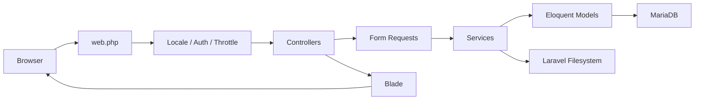

# Architecture

## Decisions

Use one Laravel 12 application with server-rendered Blade for public and administrative pages. Use MariaDB through Laravel's MySQL driver, Eloquent, migrations, transactions, Form Requests, policies, and focused services. Tailwind CSS is compiled through Vite locally; Alpine.js handles small client-side interactions. Use Livewire only when a server-rendered workflow materially benefits from it. Shared-hosting production must not depend on Node.js, SSH, Docker, Redis, or a persistent worker.

## Request flow

Public routes only query published, currently eligible content. Admin routes require session authentication plus backend permission checks; hiding sidebar links is only a UI aid. Shared media validation and storage belong in one service. Keep controllers focused on HTTP concerns, put reusable policy in services, and use policies/Spatie checks for resource authorization.

## Suggested application layout

Use `app/Http/Controllers/Public`, `Admin`, and `Auth`; `app/Http/Requests`; `app/Models`; `app/Policies`; `app/Services/{Content,Media,Localization,Authorization,Support}`; Blade layouts/components and `public`, `admin`, `auth` views under `resources/views`; translation files under `lang/en` and `lang/hi`; routes in `routes/web.php`; schema in `database/migrations`; and automated checks in `tests/Feature` and `tests/Unit`.

## Deployment and bootstrap

Compile assets and install production Composer dependencies locally. Package `vendor/`, `public/build/`, application code, and required storage structure; exclude local secrets and development artifacts. Prefer the domain document root pointing at Laravel `public/`; otherwise place application files and private storage outside the web root and use a reviewed front-controller layout. Fail deployment review if `.env`, source, or private uploads are web-accessible.

Because production has no shell, use a narrowly scoped, one-time setup flow only when the database has no portal administrator. Protect it with a high-entropy deployment-only installer secret supplied through hosting configuration, accept the initial admin password from the operator, create roles/admin transactionally, and permanently disable the flow after success. Never expose arbitrary Artisan execution or hardcoded initial credentials. Exact hosting mechanics need confirmation with the account/provider.

## Operational constraints

Scheduled publication is determined at request time, optionally assisted by ordinary cron; no worker is required. Use database-backed sessions or files according to hosting support. Backups, rollback, PHP extension/version, database version, upload limits, and permissions must be confirmed before release.
