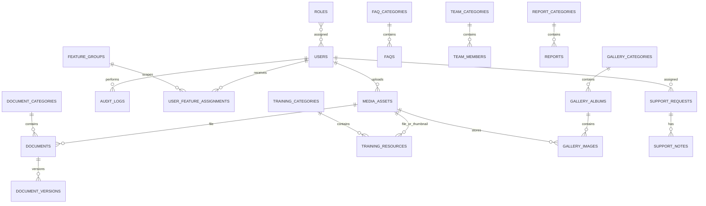

# Database Design

Use MariaDB/InnoDB, `utf8mb4`, foreign keys, indexes on search/filter/publication fields, and Eloquent migrations. Store file metadata and storage keys in MariaDB; never store large binary content in the database. Bilingual content uses explicit `*_hi` / `*_en` fields.

## Entity groups

## Tables and relationships

- **Identity and access:** Laravel `users`; Spatie `roles`, `permissions`, and pivot tables; `feature_groups`; `user_feature_assignments` with user, feature group, and effective permission references; `audit_logs` with actor, action, module, entity type/ID, timestamp, optional IP, and redacted change summary.
- **Homepage:** singleton `department_information`; `notices`, `announcements`, manually authored `homepage_updates`, `quick_links`, `banners`, `kpis`, and `homepage_sections`. Content entities include bilingual text, lifecycle state, ordering, creator/updater, and publication/expiry timestamps where relevant. Notices/announcements reference media assets for attachments; department info and banners reference images. Homepage section JSON settings configure source modules and carousel behavior.
- **Resources:** hierarchical `document_categories` → `documents` → `document_versions`; `training_categories` → `training_resources`; `faq_categories` → `faqs`; `report_categories` → `reports`. Documents/reports store category, bilingual metadata, file asset, reference/period fields, and lifecycle state.

  The resource schema is implemented in `laravel-app/database/migrations/2026_10_28_000001_create_resource_management_tables.php`. Categories and content retain soft-deleted records; category deletion is restricted while children reference it, and document history cascades with its document. Media assets are referenced by foreign key and file bytes remain in filesystem storage. Content models support draft, published, scheduled, and archived states with request-time publication/expiry filtering through `ScopesPublicLifecycle`.
- **People and gallery:** `team_categories` → `team_members` (public profile data remains separate from login users). Team profiles hold bilingual names/designations/responsibilities, optional contact and registration data, a photo media reference, active/publication state, and order. `gallery_categories` → `gallery_albums` → `gallery_images`; categories/albums include bilingual labels/descriptions and cover media, albums include event date and publication lifecycle, and image rows reference one `media_assets` record with bilingual captions/alt text and order. Public queries must require active categories/albums/images and public media visibility.
- **Contact and shared settings:** singleton/versioned `contact_details`; `support_requests` → `support_notes` with a unique public reference and status; shared `media_assets` with original name, storage disk/key, MIME, size, checksum, uploader, visibility; key/value `site_settings` with explicit types and protected-setting permissions.

## Data rules

Use foreign keys with deliberate delete behavior. Do not cascade-delete media referenced by live content. Protect category deletion when active children exist; require reassignment or explicit archive/reassignment. Use indexes for `status`, `published_at`, `expires_at`, category foreign keys, display order, and searchable bilingual title/name fields. Store dates as database datetimes in a consistent application timezone and render localized output. KPI values remain manually managed unless a future explicit configuration enables derivation.
